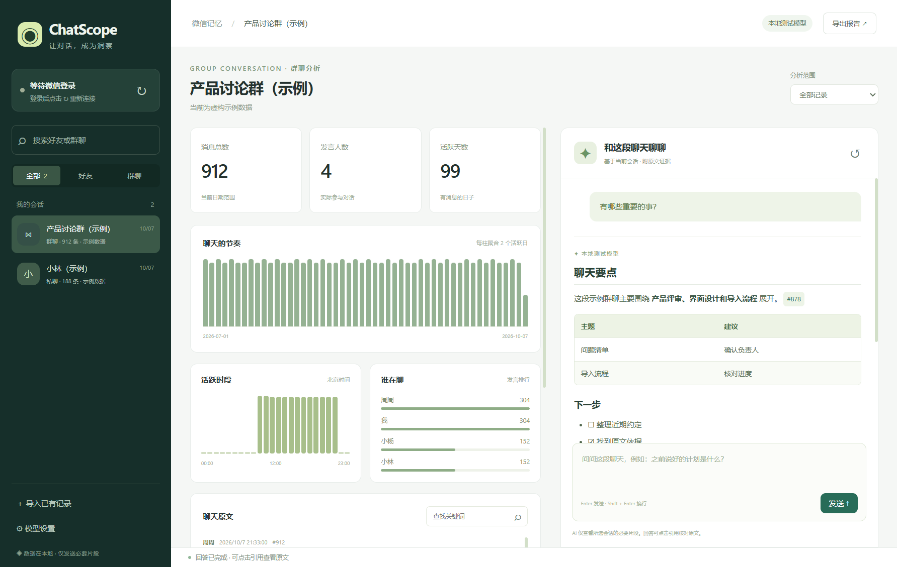
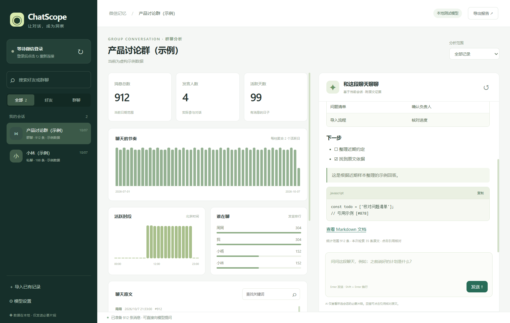
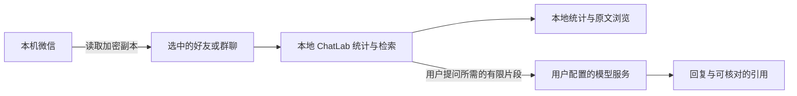

<p align="center">
  
</p>

<p align="center">
  <a href="https://github.com/wyykkk-sudo/ChatScope/releases/tag/v0.1.2"></a>
  
  
  
  <a href="LICENSE"></a>
</p>

<h3 align="center">打开微信 → 选择好友或群聊 → 和这段聊天直接交流</h3>

<p align="center">
  自动连接本地微信记录，结合 ChatLab 分析与大模型检索，让重要的约定、讨论和线索更容易找到。
</p>

<p align="center">
  <a href="https://github.com/wyykkk-sudo/ChatScope/releases/download/v0.1.2/ChatScope-Setup-0.1.2-x64.exe"><b>⬇ 下载 Windows EXE 安装版</b></a>
  &nbsp; · &nbsp; <a href="https://github.com/wyykkk-sudo/ChatScope/releases/download/v0.1.2/ChatScope-Windows-x64.zip">免安装 ZIP</a>
  &nbsp; · &nbsp; <a href="#-快速开始">快速开始</a>
  &nbsp; · &nbsp; <a href="#-markdown-回复">Markdown 回复</a>
  &nbsp; · &nbsp; <a href="#-数据与隐私">数据与隐私</a>
  &nbsp; · &nbsp; <a href="https://github.com/wyykkk-sudo/ChatScope/issues">反馈问题</a>
</p>

---

## 🛠️ v0.1.2 兼容修复

修复 DeepSeek / 兼容接口返回的内部检索指令被显示为回答的问题。现在会自动执行检索并整理成正常回答；旧的异常回复会提示重新提问。已有安装版关闭后直接安装新版本，聊天数据和模型配置继续保留。

## ✨ 一条连续的使用流程

| ① 打开微信 | ② 选择会话 | ③ 直接提问 |
| :--- | :--- | :--- |
| 登录电脑微信，启动 ChatScope | 左侧自动列出好友与群聊 | 查看统计，输入问题，点击引用核对 |
| 自动定位本机数据 | 选中后自动准备该会话记录 | 模型按需搜索原文与上下文 |

**无需手动导出、转换或导入。** 首次配置模型后，后续使用只需选择会话、输入问题。

## 🖼 界面预览



<p align="center"><sub>截图使用虚构示例记录与本地模拟模型，展示软件真实界面；不包含个人聊天。</sub></p>

<details>
<summary><b>查看统计分析界面</b></summary>



</details>

## 🧩 能做什么

| 功能 | 说明 |
| --- | --- |
| **自动连接微信** | 发现正在运行的微信、数据目录、好友与群聊；多账号时提供选择 |
| **所选聊天自动准备** | 读取对应消息分库与已提交日志，自动交给 ChatLab 分析 |
| **客观统计** | 消息总数、发言人数、活跃日期、时段分布和发言排行 |
| **范围与原文搜索** | 全部记录、最近 30 / 90 天、自定义日期；关键词查找与分页浏览 |
| **围绕聊天提问** | 支持 DeepSeek、其他兼容接口与本地 Ollama，按需检索当前会话 |
| **证据可核对** | 回答中的有效引用可点击，展开附近原文，区分统计、原话与推断 |
| **Markdown 排版** | 标题、列表、表格、引用、代码块、链接与一键复制代码 |
| **本地问答与报告** | 按会话保存问答历史，导出包含原始 Markdown 和证据的报告 |
| **已有记录兼容** | 可额外导入 EchoTrace / WeFlow / ChatLab 的 JSON / JSONL 记录 |

### 你可以这样问

> “最近有什么明确的约定或待办？请附原文。”
>
> “之前讨论的项目计划是什么？有哪些时间节点？”
>
> “这段聊天什么时候最活跃？用客观统计说明。”

## 🚀 快速开始

### 1. 下载并安装

下载 **[ChatScope-Setup-0.1.2-x64.exe](https://github.com/wyykkk-sudo/ChatScope/releases/download/v0.1.2/ChatScope-Setup-0.1.2-x64.exe)**，双击后按提示安装。安装版为当前 Windows 用户安装，无需管理员权限，并提供桌面和开始菜单入口。

也可从 [v0.1.2 Release](https://github.com/wyykkk-sudo/ChatScope/releases/tag/v0.1.2) 下载免安装 ZIP，将整个压缩包解压到可写文件夹。

两种版本均内置运行环境，不需要另行安装 Node.js、Python、ChatLab 或导出工具。安装、升级与数据保留说明见 [安装指南](docs/INSTALLATION.md)。

### 2. 打开微信，再打开 ChatScope

登录 **Windows 微信 4.x**，从桌面或开始菜单启动 **ChatScope**；免安装版直接双击 **`ChatScope.exe`**。

首次连接可能需要 **1–3 分钟**，之后会复用由当前 Windows 账户加密保护的读取配置。软件未发现已登录微信时会定期重试，也可点击左侧 **↻**。

### 3. 选择好友或群聊

点击左侧会话，软件自动读取所选聊天并显示统计、原文和问答区域。

### 4. 首次连接模型

点击左下角 **模型设置**，填写服务地址、模型名和 API Key。使用云端服务时，勾选允许发送本次问题所需的聊天片段，点击 **保存并测试**。

| 服务 | 接口地址 | 模型名称 |
| --- | --- | --- |
| DeepSeek | `https://api.deepseek.com/v1` | `deepseek-chat` |
| 其他兼容接口 | 服务商提供的 HTTPS 地址 | 服务商提供的模型名称 |
| 本地 Ollama | `http://127.0.0.1:11434/v1` | 本机已安装的模型，如 `qwen3:8b` |

接口需支持 **Chat Completions 与工具调用**。Ollama 和对应模型需要自行准备；模型调用费用由服务商收取。

**配置只需保存一次。之后选择会话，就可以直接提问。**

## 📝 Markdown 回复

从 **v0.1.1** 起，模型返回的 Markdown 会直接排版显示。

| 排版 | 支持情况 |
| --- | --- |
| 标题、粗体、斜体、删除线 | ✅ |
| 有序 / 无序列表、嵌套列表、任务清单 | ✅ |
| 引用、分隔线 | ✅ |
| 表格 | ✅ 宽表格可横向滚动 |
| 行内代码、围栏代码块 | ✅ 显示语言，支持一键复制 |
| HTTP / HTTPS 链接 | ✅ 点击后在浏览器打开 |
| 聊天证据引用 | ✅ 保留可点击的原文引用 |

Markdown 组件随软件打包，在本地完成解析与清理。回复中的脚本不会执行；图片显示说明，不自动加载外部图片。代码中的 `[#123]` 保留为代码文本，正文中的有效引用仍可点击核对。

<details>
<summary><b>查看本次更新的完整说明</b></summary>

见 [更新记录](app/CHANGELOG.md)。问答历史与导出报告保留原始 Markdown，方便继续编辑或分享。

</details>

## 🔒 数据与隐私



- **微信原始数据库只读访问**，软件不会修改原始数据库。
- 运行数据保存在软件旁的 **`data/`** 文件夹。
- API Key 和微信读取材料使用 **Windows 当前账户加密保护**。
- **分析数据库和问答历史保存在本机，未整体加密。** 请妥善保管 `data/`，不要将运行后的整个软件文件夹公开分享。
- 云端问答需要授权，仅发送当前会话所需的统计与有限检索片段；默认遮盖手机号和邮箱。其他身份信息仍可能存在于片段中。
- 模型连接测试只发送测试语句；选择本地模型时，问题交给本机服务处理。

> 客观统计覆盖所选范围的全部已导入记录。模型使用有限原文检索片段，回答不代表逐条审阅了全部聊天，请按引用核对。

## 📌 当前支持范围

**Windows x64 · 电脑微信 4.x · 文字内容分析。** 当前为可运行的测试版。

| 项目 | 当前范围 |
| --- | --- |
| 记录来源 | 电脑上已有的微信聊天记录 |
| 手机独有 / 未同步 / 已删除记录 | 无法读取 |
| 图片、语音、视频 | 按类型统计，显示占位说明；不识别或转写内容 |
| 分享与回复消息 | 提取标题等可读文字 |
| 微信版本变化 | 可能影响读取方式，尚不保证兼容所有 4.x 版本 |
| 微信 3.x、macOS、Linux | 当前不支持 |
| 实际云端模型 | 需要使用自己的密钥完成连接测试 |

### 已验证

- 本机自动发现 **379 个会话、49 个群聊**，验证了 **5 个数据库**的读取材料。
- 使用真实 ChatLab 引擎验证统计、日期筛选、重复导入保护、搜索与证据上下文。
- 使用合成加密数据库验证消息日志读取、发言者映射、压缩文本和大整数消息 ID。
- 使用本地模拟模型验证“工具调用 → 聊天检索 → 引用回复”的完整流程。
- 在实际 Electron 界面验证 Markdown、复制代码、链接过滤、原文引用及打包后的启动流程。

测试中的模型接口为本地模拟服务，**尚未通过真实 DeepSeek 云端调用验证**。请在软件中使用“保存并测试”验证自己的服务配置。

## ❓ 常见问题

<details>
<summary><b>打开后没有聊天列表怎么办？</b></summary>

确认使用 Windows 微信 4.x 并已登录。首次同步后点击 ↻。如果微信数据放在自定义位置，可点击“找不到记录？选择微信数据目录”，选择 `xwechat_files` 文件夹。

</details>

<details>
<summary><b>提示无法读取微信或部分分库怎么办？</b></summary>

让微信与 ChatScope 使用相同的 Windows 用户和权限，在微信中点开所选聊天，再点击 ↻ 重新连接。程序会明确提示无法确认完整读取的情况。若微信更新导致格式变化，请反馈微信版本和错误信息。

</details>

<details>
<summary><b>新消息如何加入分析？</b></summary>

点击左侧 ↻ 重新连接，再点击对应会话，软件会根据最新本地记录重新准备分析。

</details>

<details>
<summary><b>已有 EchoTrace 或 WeFlow 的导出记录能用吗？</b></summary>

可以使用“导入已有记录”选择兼容的 JSON / JSONL 文件。日常直接连接微信的流程不要求手动导出。

</details>

<details>
<summary><b>AI 回复失败怎么办？</b></summary>

检查服务地址、模型名称、API Key、额度及工具调用支持情况。云端服务需在设置中允许发送必要片段。地址可以是 `/v1` 基址或完整 `/chat/completions` 地址；远程接口需要 HTTPS。

</details>

## 🛠 开发与源码

```text
ChatScope/
├─ app/                 桌面界面、模型问答层与 Windows 微信读取器
│  ├─ web/              前端与本地 Markdown 组件
│  ├─ lib/              ChatLab 集成与检索问答
│  └─ reader.py         微信读取模块
├─ scripts/             构建与验证脚本
├─ docs/                说明与示例界面
└─ locks/               发布版本的依赖锁文件
```

见 [开发与构建说明](docs/DEVELOPMENT.md)。Release 同时提供 **`ChatScope-source.zip`**，其中包含应用源码、测试、构建脚本和 ChatLab 对应版本的完整源码。

提交问题时请提供软件版本、Windows / 微信版本及错误信息；请勿上传私人聊天、API Key 或真实数据库。

## 🤝 开源来源与许可

ChatScope 的整合界面、问答层与 Windows 读取器在本项目中开发，应用代码使用 [MIT](LICENSE) 许可。

| 组件 / 参考项目 | 用途与许可 |
| --- | --- |
| [ChatLab](https://github.com/ChatLab/ChatLab) | 实际使用官方 CLI **0.37.5** 作为分析引擎，AGPL-3.0；分发时保留原始许可并提供对应源码 |
| [Electron](https://github.com/electron/electron) / [Node.js](https://nodejs.org/) | 桌面与运行环境，保留原始第三方许可 |
| [Marked](https://github.com/markedjs/marked) | 本地 Markdown 解析，MIT |
| [DOMPurify](https://github.com/cure53/DOMPurify) | 模型输出 HTML 清理，按 Apache-2.0 分发 |
| [wechat-suite](https://github.com/raclen/wechat-suite) / [WeChatDataAnalysis](https://github.com/LifeArchiveProject/WeChatDataAnalysis) | 公开数据库结构及读取技术参考 |

EchoTrace、WeFlow 被评估为导出与读取方案；本发布包不包含它们缺失的私有读取组件。完整说明见 [第三方许可与来源](THIRD-PARTY-NOTICES.md)。

---

<p align="center"><b>让对话，成为洞察。</b><br><sub>ChatScope · 从你选中的一段聊天开始。</sub></p>
